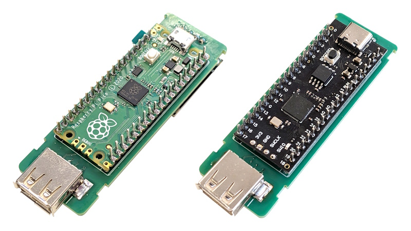
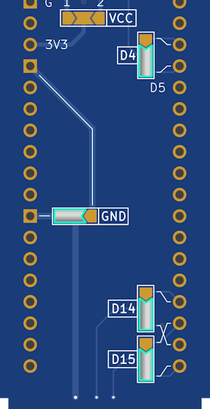

# USBvalve Universal Host Board
_PCB Gerbers for USBvalve supporting official and clone Pi Pico boards_

USBvalve is a nice little project for the Pi Pico that shows certain USB activity as it happens, to help you uncover malicious USB devices and hosts.

The official repository provides a link to a set of PCB Gerbers which you can use to mount the Pico and other components. However, it turns out that this board doesn't support some of the "unofficial" Pico clones available.

Current market conditions mean that it's likely some people will choose to buy these unofficial versions, and so it makes sense to share this PCB I created which allows you to use either. It uses the same components as the original PCB layout.

There are indentations for you to create screen mount frames if you wish, but I've found that standing the screens off with an adhesive foam pad also works.

You will need to bridge some solder jumpers just like the original board (but more) depending on the location of the specified pins on your version.

Below is the jumper arrangement for my official Pi Pico. The unofficial version I have uses the inverse. Make sure to correlate with your board.

